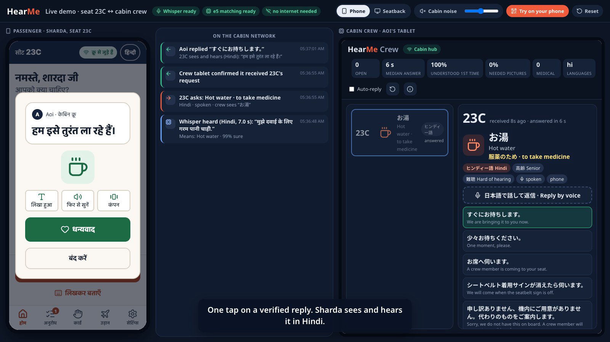

# HearMe

> Helping passengers and cabin crew understand each other. In any language. In a noisy cabin. Even with no internet.

A working prototype of *HearMe · Idea Submission* by Nidhish Bansal, Dhruv Mittal and Dibyanshu Samal.

**Example.** Sharda (68, Hindi only, a little hard of hearing) holds her phone's microphone and says *"मुझे दवाई के लिए गरम पानी चाहिए"*. Three seconds later the crew tablet shows **23C · お湯 · 薬を飲むため** (hot water, to take medicine) in Japanese. One tap on the tablet sends *"I'll bring it right away"* back to her in Hindi, on screen and read aloud. Speech recognition and matching run on a laptop standing in for the crew tablet. No internet is involved.

▶ **[Watch the 75-second demo](docs/demo.mp4)**. It was recorded from the running prototype with `npm run record-demo`.



| [Care Mode: urgent report, doctor call captioned on every seat](docs/screenshots/care-mode.png) | [Crew console](docs/screenshots/crew.png) | [Launcher](docs/screenshots/launcher.png) | [Printable seat cards](docs/screenshots/seats.png) |
| --- | --- | --- | --- |

---

## Run the demo

You need Node 20 or newer and about 1.5 GB of free RAM. ffmpeg is optional: it is only used to decode audio from native phones.

```bash
npm install
npm run demo
```

`npm run demo` does three things:

1. On the first run, it downloads the offline AI models once: Whisper-small and multilingual-e5-small, about 400 MB, into `apps/hub/.models`.
2. It builds the apps.
3. It starts the **cabin hub** and opens the **demo stage**. The stage shows the passenger phone and the crew tablet side by side, with every message that passes between them in the middle.

| Open | What |
| --- | --- |
| `http://localhost:8080/#/stage` | Demo stage. Phone or seatback on the left, crew on the right, network timeline in the middle, cabin-noise switch. |
| `http://localhost:8080/` | Launcher: every surface, the phone QR code, and printable seat cards. |
| `https://<laptop-ip>:8443/mobile/?seat=23C` | **A real phone.** Scan the QR code shown in the terminal or on the stage. The phone must be on the same Wi-Fi. |
| `http://localhost:8080/#/crew` | Crew console (dashboard). |
| `http://localhost:8080/?seat=23C#/ife` | Seatback (IFE) screen. |
| `https://<laptop-ip>:8443/seats` | Printable seat-pocket cards: a QR code per seat, plus a picture card for passengers without a phone. |

> **Certificate warning on phones.** Browsers only allow the microphone on HTTPS pages, so the hub serves the phone app over HTTPS with a self-signed certificate. The certificate is created on the first run in `apps/hub/.cert`. On the phone, choose *Advanced → Continue*. Taps and typing also work over plain HTTP.

Options: `npm run demo -- --no-ai` starts without the speech models (taps and typing still work), `--rebuild` forces a fresh build, and `--no-open` does not open a browser. `HEARME_ASR_MODEL=base` uses the smaller, faster Whisper-base model. `HEARME_THREADS=2` limits the CPU threads the models use.

---

## How it works

```
 Passenger phone (PWA, opened from the seat QR)          Crew tablet (console)
 Seatback screen (IFE)                                    Japanese, one-tap replies
          │   HTTPS + WebSocket on cabin Wi-Fi                     │
          └──────────────►  Cabin hub (Node)  ◄────────────────────┘
                             • relays meaning, not audio, scoped to the seat
                             • Whisper-small (speech → text), offline ONNX
                             • multilingual-e5-small (text → 1 of 40 needs)
                             • crew request list, booking lookup, QR codes
```

- **Tap it, say it, or point at it.** The passenger taps one of 40 pictures, holds the microphone, or types. Without a phone, they point at the printed seat card.
- **Understanding, not translation.** The hub transcribes speech with Whisper in the passenger's language, then matches the text to one of 40 known needs. Matching combines three signals:
  1. Exact keywords in 6 languages.
  2. A sound-alike tier for the way Whisper spells words it heard (for example डवा instead of दवा, or *xinh* instead of *sinh*).
  3. multilingual-e5 sentence embeddings.

  At 85% confidence or above, the request is ready to send. Below 85%, the passenger sees *"Did you mean?"* with pictures, plus *None of these, call crew*.
- **Verified replies only.** Crew replies are pre-written phrases checked in all 6 languages. A crew member can also *say* a reply in Japanese. The hub matches it to the closest verified phrase, and the crew member confirms before it is sent. Free machine translation never reaches a passenger.
- **Care Mode.** A passenger who feels unwell marks where it hurts on a body map, rates the pain 0–10, and picks symptoms and known conditions. The crew get a structured summary in Japanese and English. Urgent reports go to the top in red, and the crew can call for a doctor with one tap; the call is captioned on every seat in its own language.
- **Privacy.** Audio is processed in memory on the hub and then dropped; it is never written to disk. Only the meaning travels: need, purpose, seat, language and confidence. The seatback stores nothing and clears itself after inactivity.

| Part | Stack | Folder |
| --- | --- | --- |
| Cabin hub: HTTP/HTTPS, WebSocket relay, offline AI, booking lookup, QR codes | Node + TypeScript, `@huggingface/transformers` (onnxruntime-node), `ws` | `apps/hub` |
| Passenger phone app (also native Android/iOS through Expo) | Expo / React Native, exported to the web as a PWA | `apps/mobile` |
| Seatback screen, crew console, demo stage, launcher | React 19 + Vite | `apps/ife` |
| Shared core: catalogue of 40 needs, translations, matcher, protocol, request state machine, Care Mode, metrics | TypeScript | `packages/shared` |

---

## Measured results

All numbers come from `npm run eval` and `npm run rescore`, run on a MacBook Air (M2, 8 GB of RAM). The scripts and test phrases are in `apps/hub/src/scripts`.

**Typed requests, 6 languages.** The held-out set is 72 phrasings that were never used for tuning.

| | top-1 | right picture in top 3 | sent without asking | wrong but sent confidently |
| --- | --- | --- | --- | --- |
| Keywords only (original prototype) | 72% | 75% | 71% | 1% |
| **Keywords + e5 (now)** | **89%** | **94%** | 75% | 1% |

On the tuning set (144 phrasings), keywords + e5 reaches 97% top-1 and 100% top-3.

**Spoken requests through Whisper-small, with cabin noise.** There are 72 requests per noise level, in 6 languages, using macOS voices. Synthetic cabin noise (engine rumble, hum and airflow hiss) is mixed in at the signal-to-noise ratio shown. 0 dB means the noise is as loud as the voice.

| Noise | top-1 | sent without asking | wrong but sent confidently | median recognition time |
| --- | --- | --- | --- | --- |
| Clean | 85% | 65% | 0% | 3.2 s |
| 10 dB SNR | 85% | 64% | 1% | 3.3 s |
| 0 dB SNR | 75% | 58% | 1% | 3.2 s |

By language, across all noise levels: English 100%, Indonesian 86%, Vietnamese 86%, Japanese 89%, Hindi 72%, Thai 56%. Thai is the weak spot. The sound-alike tier raised Hindi from 42% and Vietnamese from 58%. Whisper-base is 4× faster (0.8 s) but less accurate (57–69% top-1). Set `HEARME_ASR_MODEL=base` for slow laptops.

**Crew voice replies.** 14 of 14 spoken Japanese phrasings were matched to the right verified reply, with no confident mistakes. Recognition takes about 1.7 s.

> These numbers come from synthetic voices and synthetic noise, not from real passengers in a real cabin. They show that the pipeline works and how it degrades. They are not a field result. The design favours asking with pictures over guessing: across all speech tests, at most 1% of requests were sent confidently with the wrong need.

---

## What is real and what is simulated

| Real in this prototype | Simulated or sample |
| --- | --- |
| Offline speech recognition (Whisper) and need matching (e5) on the hub | Booking lookup uses a sample passenger manifest (`apps/hub/data/manifest.json`), not an airline PNR system |
| Phone ↔ hub ↔ crew over WebSocket across devices, with seat-scoped delivery, receipts and reconnects | The crew tablet is a laptop browser; there is no certified aircraft hardware |
| Microphone capture in the phone browser (echo cancellation, noise suppression, 110 Hz high-pass filter, 16 kHz) | Seatback (IFE) is a browser page; there is no IFE platform integration |
| Seat QR → booking → language and seat filled in, no typing | Translations are prototype drafts that need native and airline review; medical wording needs clinical review |
| Offline PWA (service worker), bundled fonts, no internet calls | Without a hub, the apps fall back to a simulated crew, clearly labelled |

---

## Development

```bash
npm run dev            # Vite dev server for the web apps (proxies /api and /ws to a running hub)
npm run hub            # the cabin hub on its own
npm run mobile         # Expo dev server (Expo Go on Android/iOS); set the hub address in Settings
npm run typecheck      # shared, hub, ife, mobile
npm test               # shared (49), hub (8) and IFE (6) tests
npm run build          # Expo web export + web apps (apps/ife/dist)
npm run eval           # typed + crew evaluation; add `-- --speech --snr 10,0` for Whisper with noise
npm run rescore -w @hearme/hub   # re-score saved Whisper transcripts after matcher changes (seconds, not minutes)
npm run record-demo    # re-record docs/demo.mp4 (needs Google Chrome, ffmpeg, macOS `say`)
```

## Accessibility

- Touch targets are at least 56 dp on mobile and at least 88 px for primary seatback controls.
- Text scales to 150%; high contrast and reduce motion are available.
- The palette contrast is unit-tested against WCAG AA.
- Screen-reader roles, labels and live regions are set throughout.
- Hold-to-speak also works as tap-to-start / tap-to-finish, and from the keyboard.
- Status is always shown as icon + text + colour, never colour alone.

## Assumptions

- **Languages:** Hindi, English, Japanese, Thai, Indonesian and Vietnamese, chosen for the persona, the crew and the India / South-East Asia routes. The crew language is Japanese.
- **The hub is the crew tablet.** The PDF puts the speech AI on the crew tablet; here it is a Node service on any laptop on the cabin Wi-Fi.
- **The seatback has no microphone or keyboard.** It offers pictures, the show-to-crew card and read-aloud replies, but no voice input.

## Remaining work

- Field test with real voices at 75–85 dB of cabin noise. Add a dedicated noise-suppression model (for example DeepFilterNet) and improve Thai.
- Professional, human-checked translations; airline-approved safety and announcement content; clinical review of Care Mode wording.
- Integration with the airline booking/PNR system and the ground handover for medical and wheelchair requests. Certified crew-tablet and IFE hardware.
- Native device testing of the Expo app. In this environment it has been exercised on the web build only.
